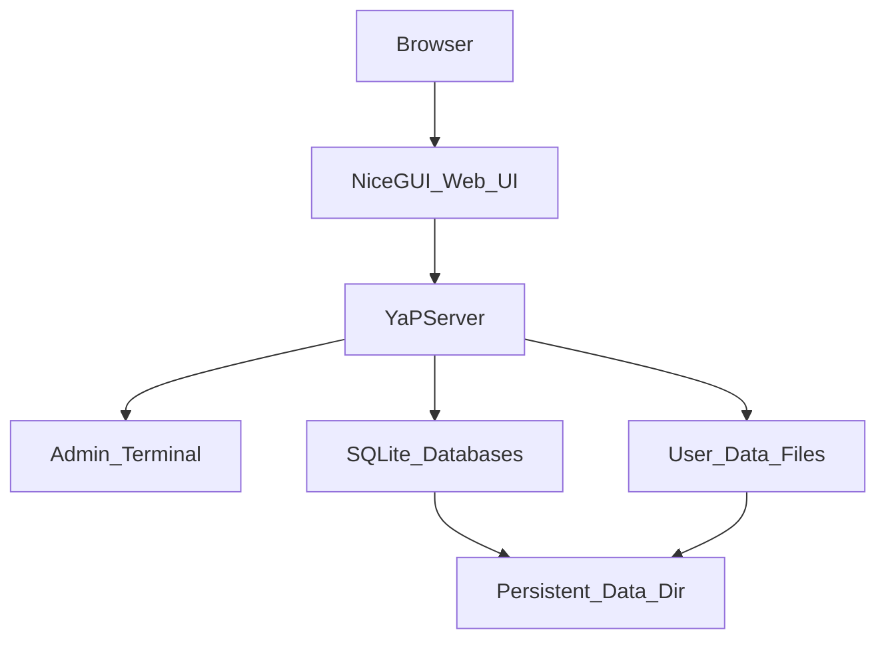

# YaPlannin

Self-hosted planning tool for breaking big goals into tasks, tracking effort over time, and staying on schedule. Run it on your own machine or in Docker, open it in a browser, and manage your plans from there.

**Version:** 0.0.1 (dev build)

---

## Features

- **Plans** — separate projects, each with its own tasks and data
- **Tasks & subtasks** — break work into chunks with start/end dates and required effort (minutes)
- **Work sessions** — log time spent on tasks and subtasks
- **Dashboard** — pressure meter, deadline warnings, lagging tasks, completion stats
- **Schedule** — week-by-week view of logged work (Monday–Sunday)
- **Accounts** — login-protected; each user has their own plans

---

## Tech stack

| Layer | Technology |
|-------|------------|
| Language | Python 3.10+ (3.12 recommended) |
| Web UI | [NiceGUI](https://nicegui.io/) (FastAPI + Vue) |
| Database | SQLite (per-plan and metadata DBs) |
| Auth | Hashed credentials stored in local data files |
| Deployment | Docker Compose (optional) |

---

## Architecture



Application code lives in this repository. User data (plans, accounts, logs, config) is stored **outside** the repo in a platform-specific directory or a Docker volume.

---

## Quick start — Docker (recommended)

**Requirements:** Docker Engine and Docker Compose v2

```bash
git clone https://github.com/CattF-LDaman/YaPlannin.git
cd YaPlannin
cp .env.example .env
# edit .env to set YAP_BOOTSTRAP_USER and YAP_BOOTSTRAP_PASSWORD !!!
docker compose up -d --build
```

Open **http://localhost:8080/login** in your browser.

See [GUIDE.MD — Docker deployment](GUIDE.MD#docker-deployment) for environment variables, backups, and troubleshooting.

---

## Quick start — local development

**Requirements:** Python 3.10+, a browser

```bash
git clone https://github.com/CattF-LDaman/YaPlannin.git
cd YaPlannin
python3 -m venv venv
source venv/bin/activate   # Windows: .\venv\Scripts\Activate.ps1
pip install -r requirements.txt
python run_server.py
```

Open **http://localhost** in your browser.

Create the first user in the server terminal:

```text
createuser myusername mypassword
```

Then sign in at **http://localhost/login**.

---

## Configuration

| Variable | Default (local) | Default (Docker) | Description |
|----------|-----------------|------------------|-------------|
| `YAP_PORT` | `80` | `8080` | Port the web UI listens on |
| `YAP_HOST` | *(NiceGUI default)* | `0.0.0.0` | Bind address |
| `YAP_DATA_DIR` | OS app-data path | `/data/YaPServer` | Server data directory |
| `YAP_HOST_PORT` | — | `8080` | Host port mapped by Docker Compose |
| `YAP_BOOTSTRAP_USER` | — | *(unset)* | Create first admin on startup if missing |
| `YAP_BOOTSTRAP_PASSWORD` | — | *(unset)* | Password for bootstrap user |

**Local example — use port 8080 without editing code:**

```bash
YAP_PORT=8080 python run_server.py
```

Copy [`.env.example`](.env.example) to `.env` for Docker Compose settings.

---

## Project structure

```text
YaPlannin/
├── YaP/
│   ├── YaPCore/          # Shared utilities, data types, logging, datetime helpers
│   └── YaPServer/        # Server, GUI, terminal commands, SQLite layer
├── docker/               # Entrypoint and bootstrap scripts
├── run_server.py         # Application entry point
├── Dockerfile
├── docker-compose.yml
├── requirements.txt
├── GUIDE.MD              # Full setup and usage manual
└── README.md             # This file
```

---

## Documentation

| Document | Contents |
|----------|----------|
| [GUIDE.MD](GUIDE.MD) | Installation, Docker deployment, usage, data storage, troubleshooting |
| [CONTRIBUTING.md](CONTRIBUTING.md) | Development setup and contribution notes |
| [CHANGELOG.md](CHANGELOG.md) | Release history |

---

## Author

Made with care by **Luwe Daman**.

Repository: [github.com/CattF-LDaman/YaPlannin](https://github.com/CattF-LDaman/YaPlannin)

---
